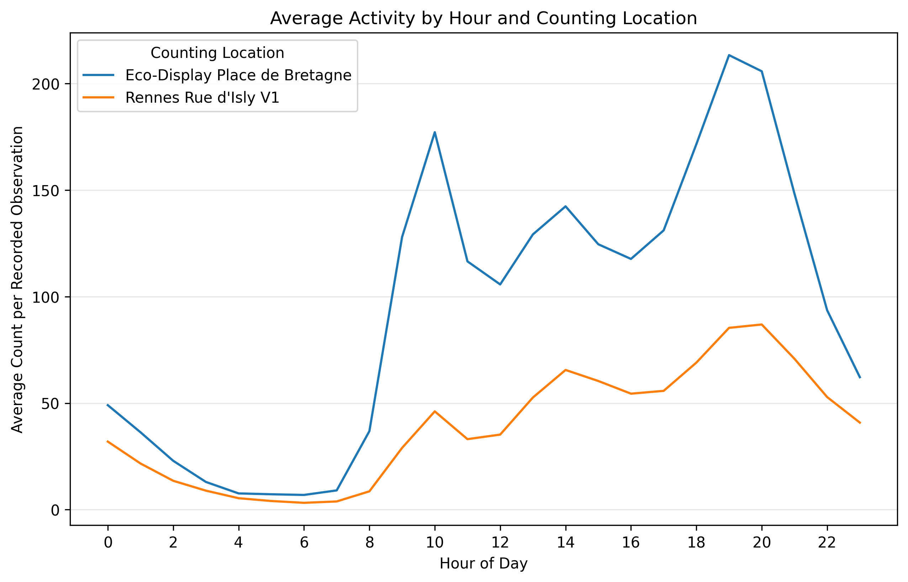
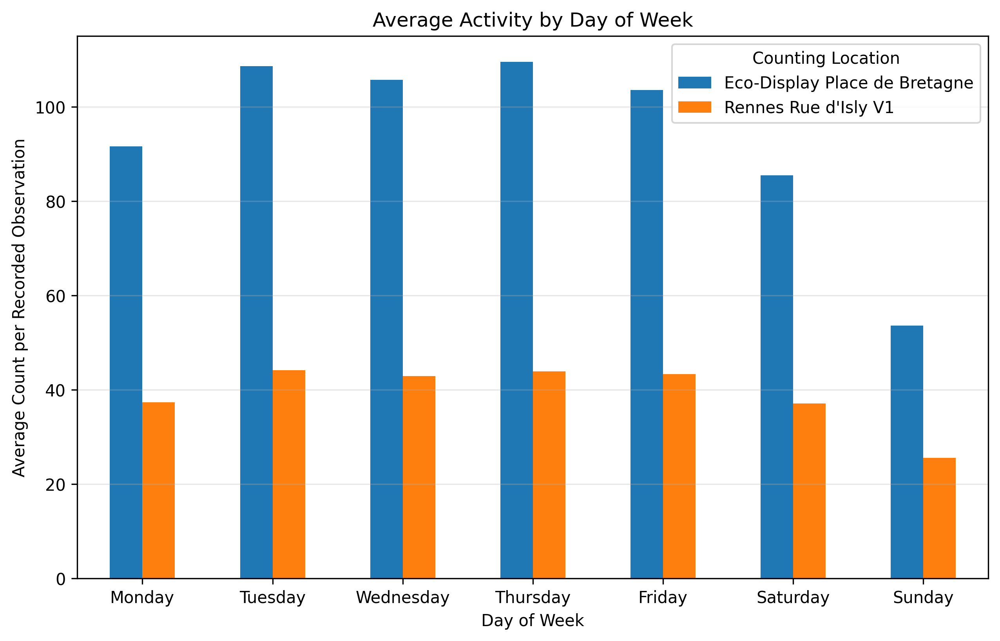
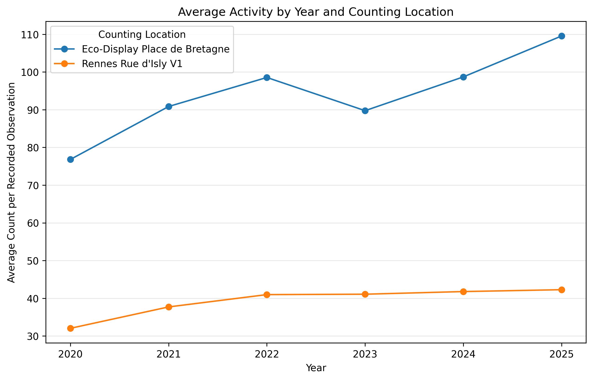

# Rennes Bicycle and Pedestrian Activity Analysis

## Project overview

This project explores how average recorded bicycle and pedestrian activity varies over time and between two counting locations in Rennes, France. The analysis uses Python and pandas to examine yearly, weekday, and hourly patterns from 2020 to 2025.

The project focuses on:

- Eco-Display Place de Bretagne
- Rennes Rue d'Isly V1

The objective is to build a reproducible exploratory analysis while checking data quality and coverage before interpreting the results.

## Dataset

The data comes from the official [Comptages vélo et piétons](https://data.rennesmetropole.fr/explore/dataset/eco-counter-data/) dataset published by Ville de Rennes through Open Data Rennes.

- Snapshot downloaded: November 5, 2026
- Raw snapshot: 165,994 rows and 9 columns
- Data license: Open Database License (ODbL)
- Analysis period: 2020–2025
- Final comparison scope: 101,666 recorded observations across two named locations

The source dataset is updated over time. A fixed CSV snapshot is included so the analysis can be reproduced with the same records.

## Data preparation

The workflow includes:

1. Inspecting the dataset structure, missing values, and duplicate rows.
2. Removing 3,767 rows with missing `counts`, leaving 162,227 usable observations.
3. Preserving valid observations even when other metadata fields are missing.
4. Converting timestamps to UTC and then to the `Europe/Paris` timezone.
5. Creating year, month, weekday, and hour features from local time.
6. Restricting the final comparison to the two selected counters and the 2020–2025 period.
7. Checking coverage before comparing averages.

Missing observations are not treated as zero.

## Key findings

### Hourly patterns

Place de Bretagne reaches its highest average recorded count at 19:00, with approximately 213.36 counts per recorded observation. Rue d'Isly reaches its maximum at 20:00, with approximately 86.92.

Hourly coverage is stable within each location. Place de Bretagne has between 2,184 and 2,191 observations per hour, while Rue d'Isly has between 2,030 and 2,050. The observed peak hours are therefore not based on unusually low hourly coverage.



### Weekday patterns

Place de Bretagne records higher averages throughout the week and peaks on Thursday at approximately 109.50. Rue d'Isly peaks on Tuesday at approximately 44.17. Both locations show lower average activity during the weekend, with Sunday recording the lowest values: 53.62 at Place de Bretagne and 25.57 at Rue d'Isly.



### Yearly patterns

Place de Bretagne has a higher average recorded count in every year of the analysis. Both locations reach their highest average in 2025: approximately 109.55 at Place de Bretagne and 42.27 at Rue d'Isly.

Rue d'Isly shows a steadier upward pattern from 32.03 in 2020 to 42.27 in 2025. Place de Bretagne rises overall but declines from 98.55 in 2022 to 89.74 in 2023 before increasing again.



## Limitations

- The results are descriptive and do not establish causes for the observed patterns.
- Data coverage is not identical across locations and years. Rue d'Isly has its largest coverage shortfall in 2022.
- The analysis uses averages per recorded observation rather than total activity, which reduces the direct effect of unequal sample sizes but does not remove all coverage limitations.
- Missing counts were excluded rather than interpreted as zero activity.
- The source dataset combines bicycle and pedestrian counts, so the results should not be presented as bicycle-only activity.
- The dataset is updated over time, so results from the live source may differ from this fixed snapshot.

## Repository structure

```text
.
├── data/
│   └── raw/
│       └── rennes_bike_pedestrian_counts_2026-11-05.csv
├── figures/
│   ├── hourly_average_by_location.png
│   ├── weekday_average_by_location.png
│   └── yearly_average_by_location.png
├── README.md
└── rennes_mobility_analysis.ipynb
```

## Tools

- Python
- pandas
- Matplotlib
- Jupyter Notebook

## How to run the analysis

1. Clone or download this repository.
2. Install the dependencies listed in `requirements.txt`.
3. Open `rennes_mobility_analysis.ipynb` in Jupyter Notebook or Visual Studio Code.
4. Restart the kernel and run all cells.

The notebook reads the fixed dataset from `data/raw/` and saves the generated charts in `figures/`.
